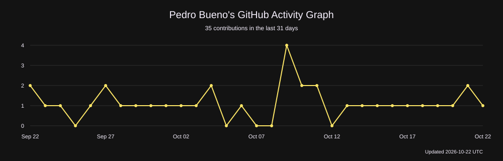

<!-- iOS-inspired dark palette: background #000000, surface #1c1c1e, text #f5f5f7, secondary #98989d, accent #0091ff. -->

<h1>Hey,  I'm Pedro Bueno</h1>

Mobile Software Engineer with native Android and iOS foundations and cross-platform experience. Open source creator and maintainer focused on mobile architecture, performance, reliability, and developer tooling.

B.S. Software Engineering at [**@Federal University Technology of Paraná**](https://www.utfpr.edu.br/).

Feel free to reach out to me on Discord!

 

<!--  -->

|  |  |
| :--------------------------------------------------------------------------------------------------------------------------------: | :-------------------------------------------------------------------------------------------------------------------------------------------------------------------------------------------: |

<table width="100%">
  <tr>
    <td align="center">
      
    </td>
  </tr>
</table>

